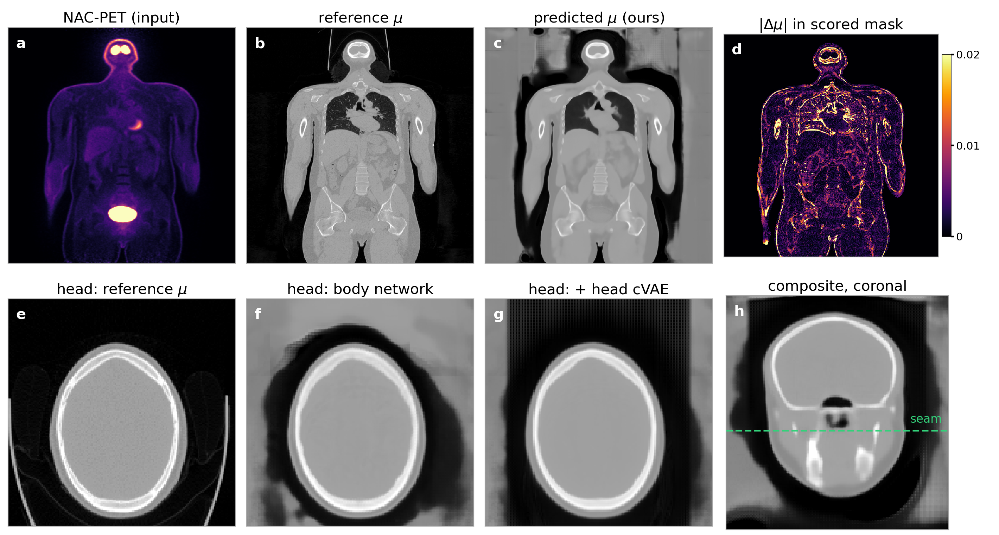
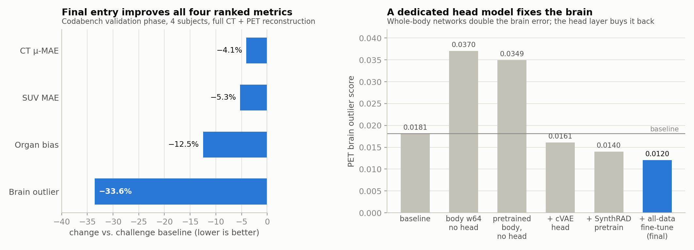
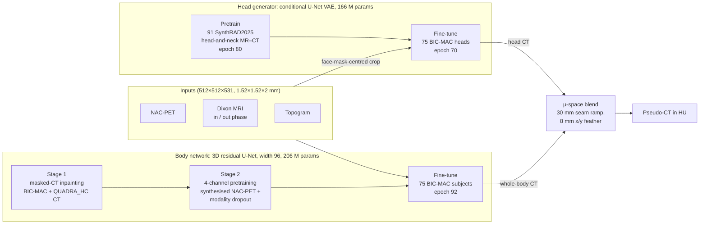
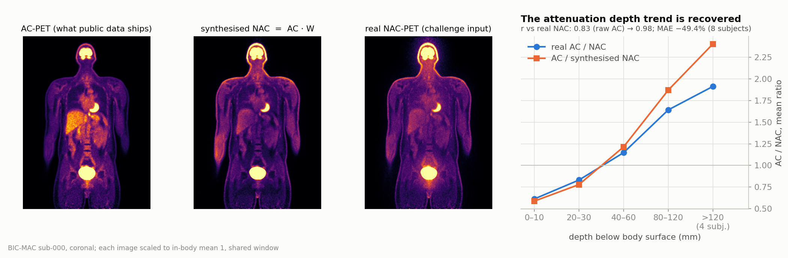
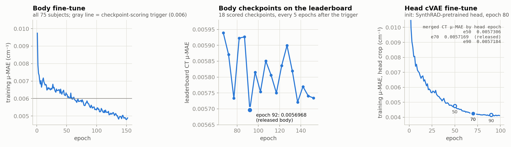

# BIC-MAC 2026: Two-Stage Pretrained Body Network + Head cVAE for Pseudo-CT

Code and weights for our entry to the [BIC-MAC 2026 challenge](https://bic-mac-challenge.github.io/)
(Big Cross-Modal Attenuation Correction, MICCAI 2026). The model predicts a
pseudo-CT from non-attenuation-corrected PET (NAC-PET), whole-body Dixon MRI and
a scanner topogram, so that PET can be attenuation-corrected without a CT scan.

**Huitian Xia, Rithihas Negisetti** · Computational Medical Imaging and Therapy Lab (CMIT),
Mallinckrodt Institute of Radiology, Washington University in St. Louis



*Top: NAC-PET input, reference μ-map, our prediction, and |Δμ| inside the scored
mask. Bottom: the skull vault with the body network alone (f) and after the head
cVAE is blended in (g); (h) shows the blend seam. `sub-000` is held out from the
head fine-tune but is in the body network's training set, so this figure is
qualitative.*

## Results

Codabench validation phase (4 subjects, full PET reconstruction from the
predicted CT). Lower is better for every metric.

| | CT μ-MAE | Whole-body SUV MAE | Organ bias | Brain outlier |
|---|---:|---:|---:|---:|
| Challenge baseline | 0.005959 | 0.03830 | 2.610 | 0.01810 |
| **This repository** (submission 890240) | **0.005717** | **0.03629** | **2.284** | **0.01203** |
| Change | −4.1% | −5.3% | −12.5% | −33.6% |

<picture>
  <source media="(prefers-color-scheme: dark)" srcset="assets/leaderboard_dark.png">
  
</picture>

Every whole-body network we trained roughly doubled the brain-outlier score
while improving the other three metrics. The head carries almost all of the
brain-outlier error and the trunk carries the SUV and organ-bias error, so the
final model is a composite of two networks. The full ablation is in
[`results/leaderboard_ablation.csv`](results/leaderboard_ablation.csv).

## Method



### Body network

The body network is a 3D residual U-Net: four pooling stages, instance norm,
LeakyReLU, base width 96. It maps the four inputs to a CT, using 192³
patches and a 0.5-overlap Gaussian sliding window at inference. Losses are
computed on the 511 keV attenuation coefficient μ, obtained from HU with the
evaluator's Carney bilinear transform, so the training objective is the scored
quantity:

$$\mathcal{L}=(1-b)\,\lVert\mu_\text{pred}-\mu_\text{gt}\rVert_1+b\,\lVert w\odot(\mu_\text{pred}-\mu_\text{gt})\rVert_1,\quad b=0.5$$

The weights $w$ are 1.5 for lung/air, 1.0 for soft tissue and 2.0 for bone, times
1.5 on the one-voxel shell between tissue classes.

The body network is pretrained twice on external data before fine-tuning:

1. **Stage 1: masked CT pretraining.** The network learns to inpaint whole-body
   CT over 171 scans (75 BIC-MAC + 96 [Vienna QUADRA_HC](https://zenodo.org/records/16588733)).
   Half of each 144³ patch is blanked in 16³ blocks, and the loss is scored only
   on blanked voxels inside the body. QUADRA's 140 kVp bone is rescaled to the
   Carney 120 kVp scale with `HU → 300 + 1.2028·(HU − 300)` above 300 HU. Against
   a randomly initialised network of the same width, this stage improves CT μ-MAE
   by 2.55% (5/5 paired checkpoints, 4.7σ).
2. **Stage 2: 4-channel pretraining with synthesised NAC-PET.** Stage 1 never
   trains the input stem: it reads 1 channel, while the real task has 4. QUADRA
   ships only attenuation-*corrected* PET, which differs from NAC-PET by a factor
   of about 3 across the body. We undo the correction in projection space,
   $\widehat{\text{NAC}} = \text{AC}\cdot\text{BP}(e^{-\mathcal{R}\mu})/\text{BP}(1)$,
   where $\mathcal{R}$ is a stack of 2-D parallel-beam Radon transforms over 50
   views and BP is an unfiltered back-projection
   ([`synthesize_nac.py`](training/body/stage1_ct_pretrain/synthesize_nac.py)).
   QUADRA samples enter as `[NAC, 0, 0, 0]`. *Modality dropout* (each sample is
   touched with p = 0.5; each channel is then zeroed with p = 0.25, keeping at
   least one) makes these samples consistent with full BIC-MAC samples. All
   206,298,049 parameters, stem included, transfer to the fine-tune.
3. **Fine-tune** on all 75 labelled BIC-MAC subjects, with no local holdout.
   Checkpoints were scored on the leaderboard every 5 epochs from epoch 67;
   epoch 92 was the best (CT μ-MAE 0.0056968), and it is the released body.

<picture>
  <source media="(prefers-color-scheme: dark)" srcset="assets/pseudo_nac_dark.png">
  
</picture>

We validated the synthesis on the 8 BIC-MAC subjects that have both PET types.
It raises voxelwise agreement with real NAC-PET from r = 0.83 to r = 0.98 and
halves the MAE, with all 8 subjects improving. It is a first-order
approximation: it overshoots the attenuation beyond about 80 mm depth, where
path lengths are longest.

### Head generator

A conditional U-Net VAE regenerates only a box around the head: 130×170×120
voxels, anchored on the centroid of the MRI face mask. It is conditioned on a
box 20 voxels larger on every side, cut from the four inputs, and has 16 latent
channels at 1/16 resolution, β = 10⁻³ with warm-up, and 0.05 free bits. Beyond
the μ loss it uses edge-aware total variation, a gradient-difference term and a
line-integral projection term, with ±10-voxel shift and ±10° rotation
augmentation. There is no left–right flip, because whole-body anatomy is
laterally asymmetric. At inference it decodes from the prior mean, so the
output is deterministic.

The head generator is pretrained on the 91 T1-Dixon head-and-neck MR–CT pairs of
[SynthRAD2025 Task 1](https://zenodo.org/records/15373853). SynthRAD has no PET
or topogram, so the MR goes in the in-phase slot and the other channels are
zero. We took the pretrained checkpoint at epoch 80, not at its best validation
loss: from epoch 80 to 134, held-out loss improved only 3.8% while training loss
improved 25%. The head was then fine-tuned on all 75 BIC-MAC heads.

### Composition

The head patch is pasted into the body prediction and blended **in μ-space**,
not in HU. The Carney transform has a kink at HU + 1000 = 1047, so a blend in
HU is not linear in the quantity the reconstruction integrates. The blend uses
a 30 mm linear ramp at the inferior edge of the box and an 8 mm cosine feather
in x/y ([`inference/blend.py`](inference/blend.py)). On one H100 a subject takes
about 90 s end to end.

## Repository layout

```
bic_mac/
├── inference/                    final pipeline: body + head + blend, Dockerfile
├── weights/                      the five checkpoints below (Git LFS) + SHA256SUMS
├── training/
│   ├── body/
│   │   ├── stage1_ct_pretrain/        masked-CT pretraining; synthesize_nac.py
│   │   ├── stage2_multimodal_pretrain/ 4-channel pretraining with pseudo-NAC
│   │   └── finetune/                  BIC-MAC fine-tune; predict.py (body only)
│   └── head/
│       ├── build_head_cache.py        BIC-MAC head-crop cache
│       ├── pretrain_synthrad/         SynthRAD cache + cVAE pretraining
│       └── finetune/                  cVAE fine-tune on BIC-MAC
├── results/                      leaderboard tables, training logs, pseudo-NAC validation
├── tools/make_figures.py         regenerates assets/
└── assets/                       README figures
```

## Weights

| File | Stage | Initialised from | Training data | Size |
|---|---|---|---|---:|
| `body_stage1_ct_pretrain.pth` | Body, stage 1 (epoch 200, exported to 4 channels, stem re-initialised) | random | BIC-MAC + QUADRA_HC CT | 825 MB |
| `body_stage2_multimodal_pretrain.pth` | Body, stage 2 (epoch 120) | stage 1 | BIC-MAC + QUADRA_HC (pseudo-NAC) | 825 MB |
| **`body_finetune_e0092.pth`** | **Body, final** (epoch 92) | stage 2 | 75 BIC-MAC subjects | 825 MB |
| `head_pretrain_synthrad_e080.pth` | Head, pretrain (epoch 80) | random | 91 SynthRAD2025 HN T1-Dixon pairs | 664 MB |
| **`head_finetune_e070.pth`** | **Head, final** (epoch 70) | head pretrain | 75 BIC-MAC heads | 664 MB |

Only the two files in bold are needed for inference. They are byte-identical to
the checkpoints scored as Codabench submission 890240. Verify them with
`cd weights && sha256sum -c SHA256SUMS`.

The body checkpoints hold a plain `state_dict` (fine-tune) or a dict with
`model_state_dict` and provenance metadata (pretraining exports). The head
checkpoints hold `{"epoch", "model", "cfg", "metrics"}`, and `cfg` carries the
architecture that `inference/head_model.py` rebuilds.

> **Cloning:** the weights are tracked with [Git LFS](https://git-lfs.com).
> Run `git lfs install` before cloning, or `git lfs pull` afterwards.

## Inference

The pipeline reads one subject's `features/` folder in the
[BIC-MAC layout](https://github.com/bic-mac-challenge/challenge-codebase#dataset-structure)
and writes `ct.nii.gz` (HU, float32) on the NAC-PET grid. It needs
`nacpet.nii.gz`, `mri_combined_{in,out}_phase.nii.gz`, `topogram.nii.gz` and
`mri_face_mask.nii.gz`.

**Python**

```bash
pip install -r requirements.txt
python inference/predict.py \
    --features_dir /path/to/sub-004/features \
    --output_ct    out/sub-004/ct.nii.gz
```

Add `--save_parts out/sub-004/parts` to also write the body-only and head-only
volumes. Set `SW_BATCH=4` to run more sliding windows at once; the arithmetic is
the same.

**Docker** (the submitted container)

```bash
docker build -f inference/Dockerfile -t bic-mac-pseudoct .        # from the repo root
docker run --rm --gpus all --network none \
    -v /path/to/sub-004/features:/data/features:ro \
    -v $PWD/out/sub-004:/data/output \
    bic-mac-pseudoct
```

`inference/run_val_subjects.sh` runs the container over the four validation
subjects the way the organizers do: one container per subject, no network and a
300 s timeout.

To turn a pseudo-CT into an attenuation-corrected PET, use the challenge's
reconstruction pipeline in the
[challenge codebase](https://github.com/bic-mac-challenge/challenge-codebase).

## Training from scratch

**Data.** Put the datasets under `data/`, or point `BIC_MAC_DATA_ROOT` at a
folder with this layout:

```
data/
├── bic-mac-data/{train,val}/sub-XXX/...                 # register at bic-mac-challenge.github.io
├── quadra-hc-data/QUADRA_HC/Imaging Data/QUADRA_HC_XXX/  # Zenodo 16588733
└── synthrad2025-data/synthRAD2025_Task1_Train/Task1/HN/  # Zenodo 15373853
```

All runs below used 4 × H100 and `torchrun --standalone --nproc_per_node=4`.
Each script reads the `config.yaml` or `ddp_config.json` next to it, and
relative paths resolve from the script's own folder. Every stage can start from
the released weights of the previous stage; the configs show the alternative
`init_checkpoint` line.

**Body network**

```bash
cd training/body/stage1_ct_pretrain
python prepare_corpus.py --workers 16            # corpus.json + QUADRA body masks
torchrun --standalone --nproc_per_node=4 train.py                        # 200 epochs
python export_encoder.py --checkpoint outputs/checkpoints/epoch_0200.pth  # -> outputs_pretrain/pretrained_init.pth
python synthesize_nac.py --validate              # synthesis vs real NAC on 8 BIC-MAC subjects
python synthesize_nac.py --quadra                # 96 QUADRA pseudo-NAC volumes

cd ../stage2_multimodal_pretrain
python prepare_corpus.py                          # corpus.json with pseudo-NAC paths
torchrun --standalone --nproc_per_node=4 train.py                        # 120 epochs
python export_init.py --checkpoint outputs/checkpoints/epoch_0120.pth    # -> outputs/stage2_init.pth

cd ../finetune
torchrun --standalone --nproc_per_node=4 train.py
```

The fine-tune's cosine schedule spans 270 epochs. The original run stopped at
epoch 152, after its last leaderboard submission, and keeps a checkpoint every 5
epochs from epoch 52; that schedule includes epoch 92. Automatic Codabench
submission from inside the trainer is turned off in the released config
(`leaderboard_eval.enabled: false`). To score checkpoints, predict the
validation subjects with `predict.py --checkpoint ...` and submit them through
the challenge codebase.

**Head generator**

```bash
cd training/head
python build_head_cache.py --with-val                  # head_cache_bicmac/, 75 + 4 subjects

cd pretrain_synthrad
python build_cache.py --workers 10                     # head_cache_synthrad/, 91 cases
python build_cache.py --validate-anchor                # optional: check the fitted SynthRAD anchor
torchrun --standalone --nproc_per_node=4 train_vae_ddp.py --config ddp_config.json   # keep epoch 80

cd ../finetune
torchrun --standalone --nproc_per_node=4 train_vae_ddp.py --config ddp_config.json   # 100 epochs, keep epoch 70
```

The head fine-tune trains on all 75 subjects with nothing held out, so it has no
early-stopping signal. We scored epochs 50, 70 and 90, each blended onto the
epoch-92 body, and released epoch 70 because it had the best CT μ-MAE.

<picture>
  <source media="(prefers-color-scheme: dark)" srcset="assets/training_dark.png">
  
</picture>

Per-epoch logs for all five runs are in [`results/logs/`](results/logs/), and
the per-checkpoint leaderboard scores are in
[`results/body_finetune_checkpoints.csv`](results/body_finetune_checkpoints.csv)
and [`results/head_finetune_checkpoints.csv`](results/head_finetune_checkpoints.csv).
Regenerate the figures with `python tools/make_figures.py`.

**Naming in code comments.** The code is released as it was run, and its
comments use our internal names: `baseline_v3`/`baseline_v7` are earlier
width-64/72 body models, `pretrain_v1` → `stage1_ct_pretrain`, `pretrain_v2` →
`stage2_multimodal_pretrain`, `finetune_v1` → `body/finetune`, `pretrain_brain` →
`head/pretrain_synthrad`, `finetune_head_v2` → `head/finetune`, and
`head_cache_v2` → `head_cache_bicmac`. References like "plan.md §5.3" point to
our internal lab notebook, which is not included.

## Limitations

- **The validation evidence is thin.** Four validation subjects carry large
  between-subject variance, and the checkpoint-to-checkpoint noise in CT μ-MAE
  is about 0.55%. The three PET metrics have no measured noise floor, so do not
  over-read few-percent differences between the last rows of the ablation.
- **Checkpoints were selected on the leaderboard.** The body was chosen as the
  best of 18 scored checkpoints, and the head as the best of 3. The released
  numbers are therefore optimistic for the test set.
- **Stage-2 pretraining generalises poorly.** The model fits the training set
  much better than it generalises (a 14–18% gap). This is where we expect the
  remaining headroom to be.

## External data and licensing

- **BIC-MAC** data is distributed by the challenge organizers after registration
  and is not included here.
- **Vienna QUADRA_HC** (Zenodo 16588733, CC-BY-4.0) was used for both body
  pretraining stages.
- **SynthRAD2025 Task 1** (Zenodo 15373853, CC-BY-NC-4.0) was used for the head
  pretrain. The two head checkpoints are derived from it, so take its
  non-commercial terms into account before reusing them.

Both external corpora were released before the challenge's 2026-04-01 data
cutoff, and were used for pretraining only. The code uses
[PyTorch](https://pytorch.org) and [MONAI](https://monai.io); PET reconstruction
follows the challenge-provided STIR pipeline.
